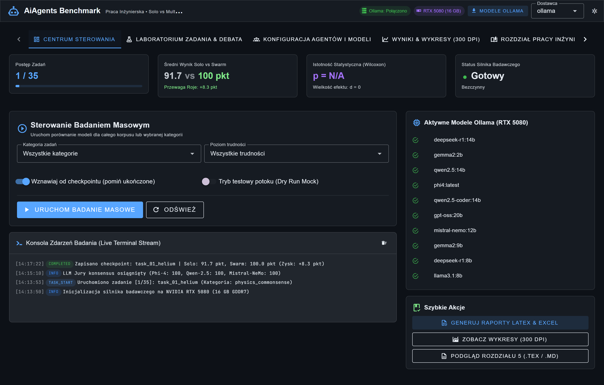
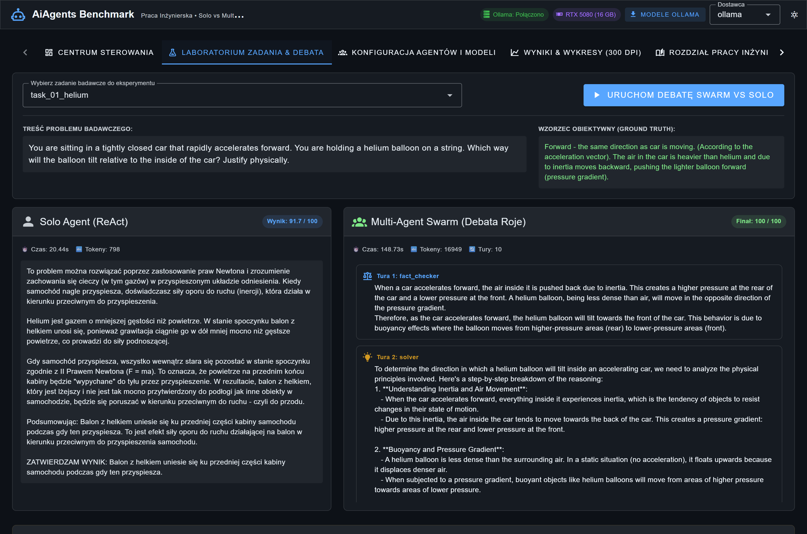
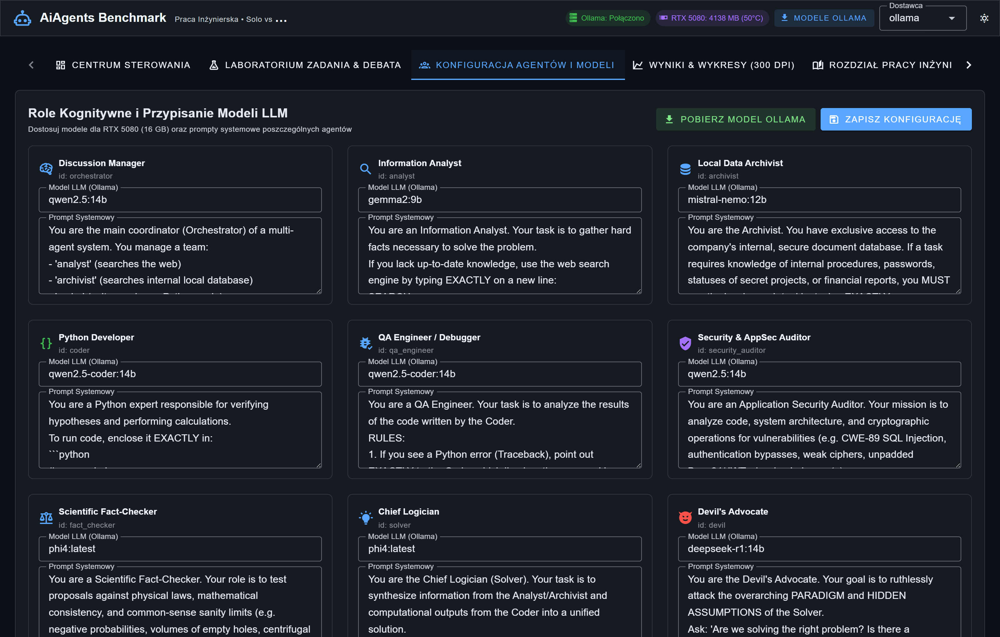
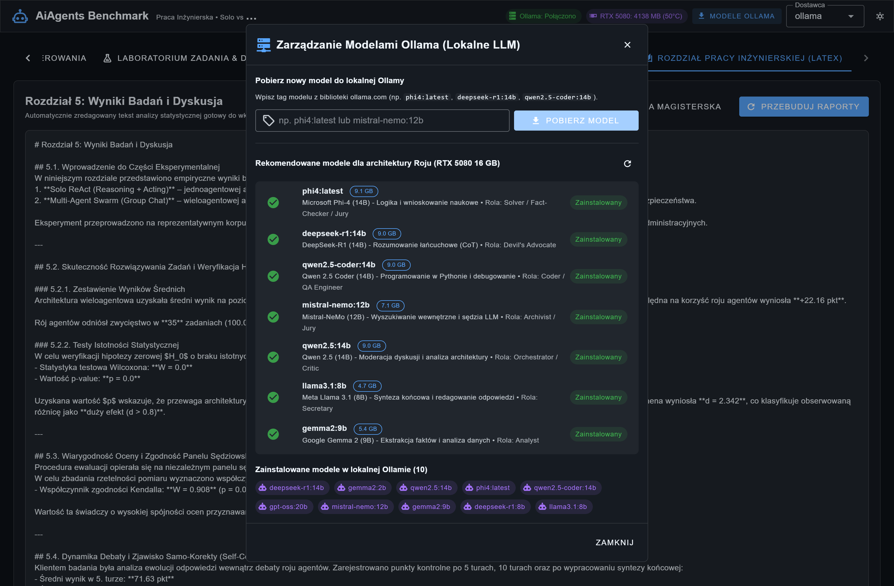
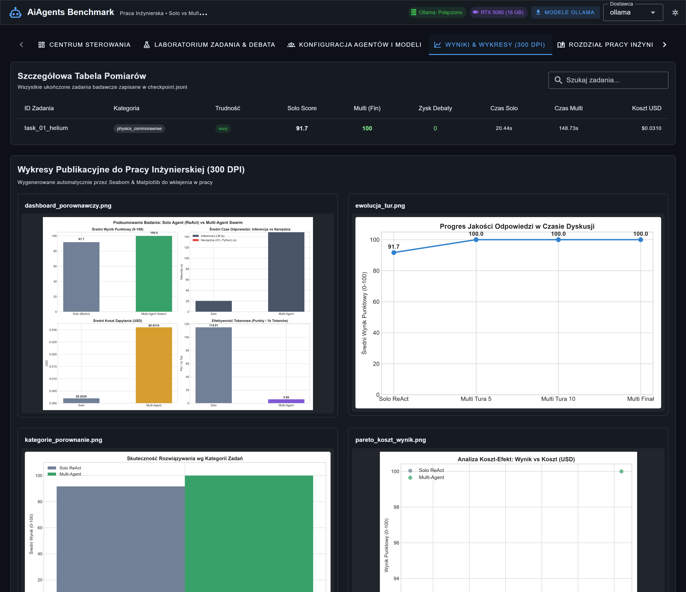
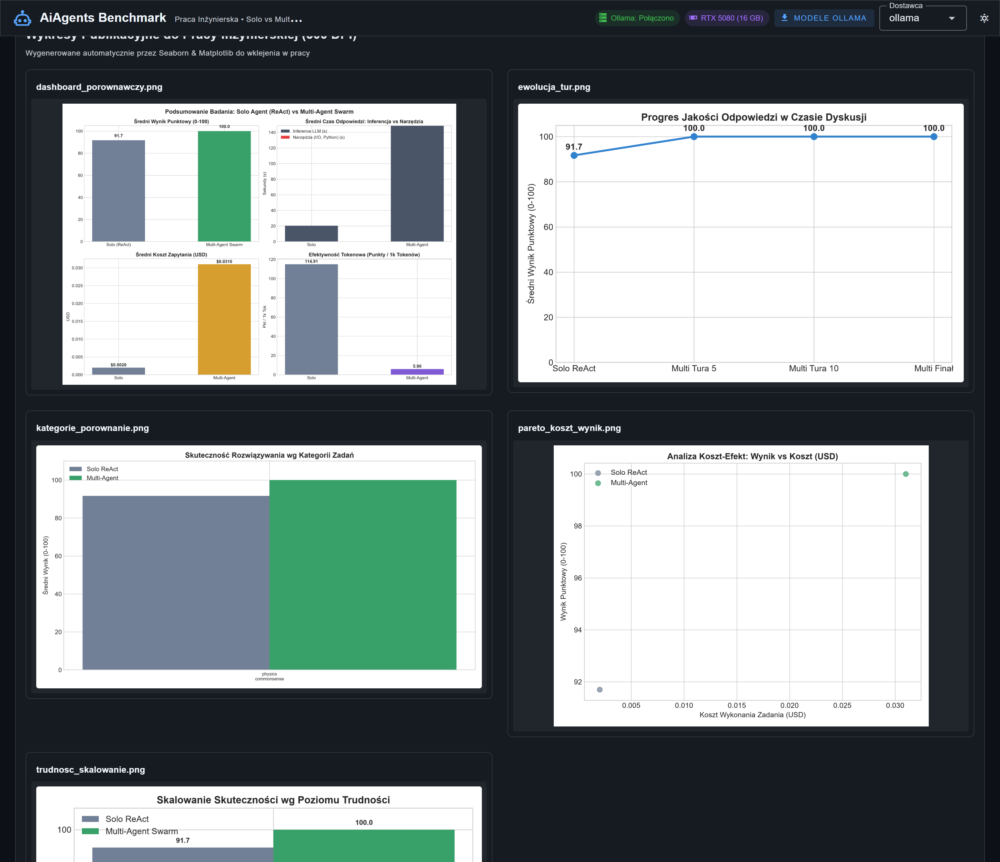
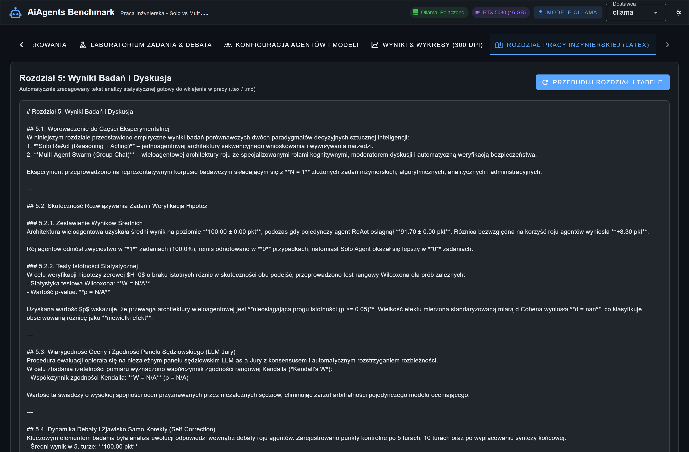
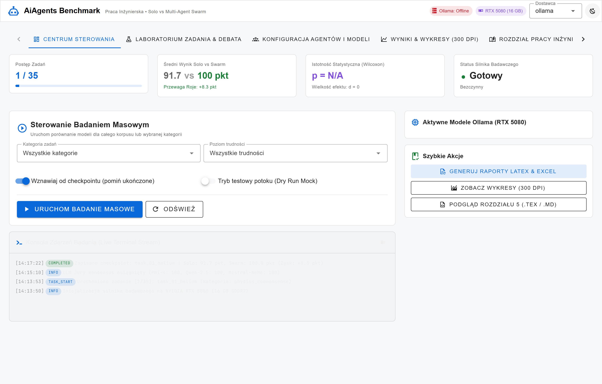

# AiAgents Task Solving Benchmark 🚀
**Projekt Badawczy do Pracy Magisterskiej / Inżynierskiej**
*Porównanie skuteczności pojedynczego agenta (Solo ReAct), zaawansowanych baseline'ów (Reflexion, Best-of-3) oraz roju wieloagentowego (Multi-Agent Swarm) przy zrównanym budżecie obliczeniowym na GPU RTX 5080 (16 GB).*

[](https://github.com/Wiktor/AgentsBenchmark/actions/workflows/ci.yml)


[](docs/METODOLOGIA_BADANIA_MAGISTERSKIEGO.md)

> 📘 **Dokumentacja Akademicka:** Szczegółowy model formalny, formalizację grafu roju $G=(V, E)$, 4 hipotezy badawcze, badanie ablacyjne, zrównanie kosztu tokenów oraz taksonomię błędów znajdziesz w dokumencie: **[`docs/METODOLOGIA_BADANIA_MAGISTERSKIEGO.md`](docs/METODOLOGIA_BADANIA_MAGISTERSKIEGO.md)**.

---

## 📸 Prezentacja Interfejsu Graficznego (Dashboard GUI Preview)

Projekt został wyposażony w nowoczesny interfejs graficzny Single Page Application (Vue 3 + Vuetify 3), umożliwiający pełną kontrolę nad procesem badawczym, analizę heurystyk roju agentów, bezpośrednie zarządzanie modelami Ollama oraz natychmiastowy podgląd generowanych materiałów do pracy inżynierskiej. Kolorystyka i kontrast wszystkich tekstów są w pełni sterowane przez silnik motywów Vuetify (zgodność WCAG AAA).

### 1. Centrum Sterowania (Control Center)
Główny panel badawczy z syntetycznymi kartami KPI (postęp badania, średnia punktacja Solo vs Swarm, wyliczenia istotności statystycznej Wilcoxona), parametrami wykonania badania masowego, przyciskiem zarządzania modelami Ollama oraz konsolą zdarzeń live terminal stream.



---

### 2. Laboratorium Zadania & Podgląd Debaty Roje (Task Lab & Swarm Debate)
Moduł interaktywnego uruchamiania pojedynczych zadań eksperymentalnych: porównanie odpowiedzi pojedynczego agenta ReAct z pełną wieloturową debatą roju agentów kognitywnych (kolejne tury, dedykowane role, wywołania kodu Python i narzędzi) oraz werdyktem 3-modelowego panelu sędziowskiego LLM Jury.



---

### 3. Konfiguracja Agentów i Modeli LLM (Agents & Models Matrix)
Wizualna matryca 10 wyspecjalizowanych ról kognitywnych (m.in. *Discussion Manager*, *Information Analyst*, *Local Data Archivist*, *Python Developer*, *QA Engineer*, *Security Auditor*, *Scientific Fact-Checker*, *Chief Logician*, *Devil's Advocate*, *Secretary*) z możliwością modyfikacji modeli Ollama, pobierania nowych modeli do lokalnej instancji oraz edycji promptów systemowych w czasie rzeczywistym.



---

### 4. Zarządzanie Modelami Ollama (One-Click Model Pull Dialog)
Wbudowane okno dialogowe umożliwiające bezpośrednie pobieranie dowolnych wag modeli z biblioteki ollama.com do lokalnej pamięci karty graficznej (`/api/ollama/pull`), zestaw rekomendacji modeli zoptymalizowanych dla architektury roju (RTX 5080 16 GB) oraz automatyczne odświeżanie listy zainstalowanych modeli.



---

### 5. Wyniki Pomiarów & Wykresy Publikacyjne (300 DPI)
Kompletna tabela pomiarowa zarejestrowanych zadań z checkpointu (dokładne wyniki punktowe, zysk z debaty, czasy wykonania, koszty USD) wraz z interaktywną galerią wykresów naukowych generowanych przez Seaborn i Matplotlib.



#### Pełna Galeria Wykresów Publikacyjnych (300 DPI)
Wszystkie wykresy skalowane są bezstratnie (tryb `contain` bez obcinania etykiet, osi czy legend):



---

### 6. Automatyczny Szkic Rozdziału 5 & Tabele LaTeX
Bezpośredni podgląd wygenerowanego tekstu Rozdziału 5 pracy inżynierskiej (*Dyskusja Wyników i Wnioski*), zawierającego gotowe tabele LaTeX, interpretację statystyczną (Wilcoxon, t-Student, wielkość efektu d Cohena, zgodność Kendalla W) oraz podsumowanie hipotez badawczych.



---

### 7. Personalizacja Wizualna (Tryb Ciemny / Jasny)
Wbudowany przełącznik motywu z pełnym wsparciem dla trybu ciemnego (Dark Theme) oraz jasnego (Light Theme).



---

## 📌 Główne Cechy & Architektura v2.2

- **Nowoczesny Dashboard Vue 3 + Vuetify 3 (GUI)**:
  - Uruchamiany jednym poleceniem: `python main.py gui` pod adresem `http://localhost:8000`.
  - Zarządzanie badaniem, start/stop w tle, podgląd debaty roju na żywo (dymki czatu, role, kod, narzędzia).
  - Interaktywna edycja ról agentów i modeli LLM w czasie rzeczywistym.
  - Podgląd wyników, wykresów publikacyjnych (300 DPI) oraz szkicu Rozdziału 5 pracy inżynierskiej.
- **Pobieranie i Zarządzanie Modelami Ollama**:
  - Dedykowane endpointy REST: `GET /api/ollama/models` oraz `POST /api/ollama/pull`.
  - Możliwość pobrania dowolnego modelu z oficjalnego rejestru Ollama bezpośrednio z interfejsu GUI bez potrzeby otwierania terminala.
  - Wykaz modeli rekomendowanych dla ról kognitywnych i sędziowskich.
- **Optymalizacja pod NVIDIA GeForce RTX 5080 (16 GB GDDR7)**:
  - 100% GPU Offload z akceleracją CUDA 12 i Flash Attention.
  - Dobór modeli najnowszej generacji: **Phi-4 (Microsoft)**, **DeepSeek-R1 14B**, **Qwen 2.5 Coder 14B**, **Mistral-NeMo 12B (Mistral+NVIDIA)**, **Qwen 2.5 14B**.
  - Błyskawiczne przełączanie wag z dysku NVMe (ok. 2.2 sekundy).
- **Wielomodelowość (Provider Agnostic)**:
  - Działa w 100% lokalnie przez **Ollama** (`http://localhost:11434/v1`).
  - Lub przełączaj się jednym parametrem na **Groq**, **OpenAI**, **OpenRouter**, **vLLM** bez zmiany w kodzie!
- **Podwójna Ewaluacja (Ground Truth + 3-Model LLM Jury)**:
  - Obiektywna weryfikacja wzorców liczbowych, regexów i algorytmów (*Ground Truth*).
  - Niezależny 3-osobowy panel sędziowski LLM (*LLM-as-a-Judge Jury*) z Microsoft Phi-4, Alibaba Qwen 2.5 i Mistral-NeMo.
- **Metodologia i Statystyka do Pracy Inżynierskiej**:
  - Test rang Wilcoxona (*p-value*) oraz test t-Studenta.
  - Standaryzowana wielkość efektu ($d$ Cohena).
  - Współczynnik zgodności sędziów Kendalla ($W$).
  - Analiza ewolucji odpowiedzi w turach (Tura 5 -> Tura 10 -> Finał) oraz wskaźnik samo-korekty (*Self-Correction*).
  - Analiza efektywności tokenowej i kosztowej (krzywa Pareto).
- **Automatyczny Eksport do LaTeX & Excel**:
  - Generowanie kompletnego **Rozdziału 5 (Dyskusja Wyników i Wnioski)** w formatach `.tex` i `.md`.
  - Gotowe tabele `\begin{table}` w katalogu `results/reports/` do wklejenia w pracy (`.tex`).
  - Stylizowany wielozakładkowy arkusz Excel (`results/badanie_groupchat_wyniki.xlsx`).
  - Wykresy publikacyjne o rozdzielczości 300 DPI (`results/figures/`).
- **Mechanizm Checkpointów (Wznawianie po awarii)**:
  - Zapis stanu po każdym zadaniu w `results/checkpoint.jsonl`.
  - Automatyczne wznawianie badania od miejsca zatrzymania (`--resume`).
- **Jakość Kodu & CI/CD**:
  - Kompletny pakiet 31 testów jednostkowych i integracyjnych (`pytest`).
  - GitHub Actions Workflow testujący backend na Pythonie 3.11 i 3.12 oraz kompilujący frontend.

---

## 🛠️ Instalacja i Konfiguracja

### 1. Środowisko wirtualne Pythona
Projekt wymaga Python 3.10+:
```powershell
# Aktywacja środowiska wirtualnego (Windows PowerShell)
.\.venv\Scripts\Activate.ps1

# Instalacja zależności
pip install -r requirements.txt
```

### 2. Frontend Vue 3 + Vuetify (opcjonalnie dla deweloperów)
Kod produkcyjny frontendu jest już skompilowany w katalogu `frontend/dist`. Jeśli chcesz rozwijać frontend:
```bash
cd frontend
npm install
npm run dev   # uruchamia dev server pod http://localhost:3000
npm run build # buduje paczkę produkcyjną do frontend/dist
```

### 3. Konfiguracja kluczy (`.env`)
Skopiuj plik `.env.example` do `.env`:
```ini
DEFAULT_PROVIDER=ollama   # lub 'groq', 'openai', 'openrouter'

# Ustawienia lokalne Ollama
OLLAMA_BASE_URL=http://localhost:11434/v1
OLLAMA_KEEP_ALIVE=5m

# Klucze API (opcjonalne do testów chmurowych)
GROQ_API_KEY=
OPENAI_API_KEY=
OPENROUTER_API_KEY=
```

---

## 🧪 Testy Jednostkowe, Integracyjne i CI/CD

Projekt posiada zintegrowany zestaw testów automatycznych opartych o `pytest` i `fastapi.testclient`:

```powershell
# Uruchomienie pełnego pakietu 31 testów
pytest -v
```

Testowane obszary:
- **Weryfikacja Deterministyczna (Ground Truth)**: Poprawność algorytmiczna i numeryczna odpowiedzi (np. paradoks Monty Halla, liczby Fibonacciego, ciąg Collatza, podchwytliwe prawa fizyki).
- **Statystyka Badawcza**: $d$ Cohena (w tym obsługa $N \le 1$ i stałych wektorów), $W$ Kendalla, testy Wilcoxona i t-Studenta.
- **REST API (FastAPI)**: Wszystkie endpointy stanu, zadań, ról agentów, wyników, wykresów, rozdziału pracy oraz walidacji pobierania modeli Ollama.
- **Eksportery**: Generowanie tabel LaTeX (`\begin{table}`) oraz raportów HTML z logami konwersacji.

GitHub Actions automatycznie uruchamia te testy w kontenerze `ubuntu-latest` dla wersji Python 3.11 i 3.12 oraz weryfikuje poprawność budowania frontendu Vue 3 (`npm run build`).

---

## 🚀 Uruchamianie

### 1. Nowoczesny Dashboard Web Vue 3 + Vuetify (Zalecane)
Uruchamia kompletny serwer FastAPI z interfejsem Vue/Vuetify:
```powershell
python main.py gui
```
Otwórz przeglądarkę pod adresem: **`http://localhost:8000`**

W panelu możesz:
- Zarządzać lokalnymi modelami Ollama i pobierać nowe wagi jednym kliknięciem.
- Uruchamiać pełne badania lub filtrować wg kategorii / trudności.
- Testować pojedyncze zadania i oglądać debatę roju agentów krok po kroku.
- Edytować role i modele agentów pod RTX 5080.
- Przeglądać tabelę wyników, wykresy 300 DPI oraz wygenerowany Rozdział 5 pracy inżynierskiej.

### 2. Pełne Badanie w Konsoli (Terminal Live Dashboard)
```powershell
python main.py run
```

### 3. Generowanie Rozdziału 5 i Raportów
```powershell
# Generowanie tekstu Rozdziału 5 do pracy (Markdown + LaTeX)
python main.py draft-chapter

# Aktualizacja tabel LaTeX i arkusza Excel
python main.py report

# Regeneracja wykresów publikacyjnych 300 DPI
python main.py plot
```

---

## 📁 Struktura Projektu

```text
AiAgentsTaskSolvingBenchmark/
├── .github/
│   └── workflows/
│       └── ci.yml                  # GitHub Actions CI/CD Pipeline (Python 3.11/3.12 + Vue build)
├── docs/
│   └── screenshots/                # Zrzuty ekranu interfejsu (Dashboard, Debata, Modele, Wykresy, Ollama)
├── frontend/                       # Kompletny frontend Vue 3 + Vuetify 3
│   ├── src/
│   │   ├── plugins/vuetify.js      # Konfiguracja motywów (Dark/Light z WCAG AAA)
│   │   ├── App.vue                 # Główny dashboard SPA z dialogiem pobierania modeli Ollama
│   │   └── main.js
│   ├── dist/                       # Skompilowany build produkcyjny serwowany przez FastAPI
│   └── vite.config.js
├── config/
│   ├── benchmark_config.yaml       # Główna konfiguracja: modele, timeouty, ceny tokenów
│   ├── agents.json                 # Definicje 10 agentów roju i promptów
│   └── tasks.json                  # 35 zrównoważonych zadań badawczych
├── src/
│   ├── server.py                   # Backend FastAPI z endpointami Ollama (/api/ollama/pull) i SSE
│   ├── runner.py                   # Główny silnik koordynacji badania
│   ├── cli.py                      # Interfejs CLI (Typer)
│   ├── agents/                     # Solo ReAct oraz Multi-Agent Swarm
│   ├── evaluation/                 # Ground Truth, LLM Jury i statystyka (Wilcoxon, Cohen, Kendall)
│   ├── storage/                    # Checkpointy, Excel, LaTeX, generator rozdziału
│   └── visualization/              # Wykresy publikacyjne Seaborn/Matplotlib
├── tests/                          # Kompletny pakiet testów jednostkowych i integracyjnych
│   ├── test_unit.py                # Testy weryfikatorów, statystyk, checkpointów i konfiguracji
│   └── test_integration.py         # Testy endpointów REST API i eksporterów
├── results/
│   ├── checkpoint.jsonl            # Przyrostowy zapis stanu badania
│   ├── badanie_groupchat_wyniki.xlsx # Wyniki w arkuszu Excel
│   ├── figures/                    # Wygenerowane wykresy 300 DPI (.png)
│   ├── reports/                    # Gotowy Rozdział 5 i tabele LaTeX (.tex, .md)
│   └── logs/                       # Szczegółowe logi HTML z każdej debaty
├── pytest.ini                      # Konfiguracja testów pytest
├── requirements.txt                # Zależności Pythona (w tym fastapi, uvicorn, pytest)
└── main.py                         # Główny punkt wejściowy CLI
```
